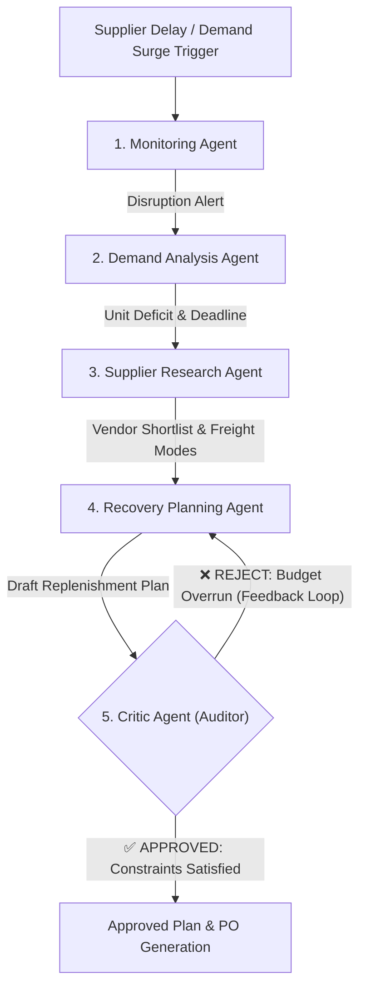

# StockShield: Autonomous Multi-Agent Supply-Chain Disruption Mitigation

A domain-specific **Agentic AI Proof of Concept (PoC)** for **Inventory & Supply Chain Management** developed for Continuous Assessment 3 (CA-3).

---

## 1. Domain & Problem Statement

* **Domain:** Inventory and Supply-Chain Management
* **Existing Challenge:** Traditional ERP and warehouse management systems are passive—they trigger threshold alerts when inventory drops, but cannot autonomously reason, evaluate supplier alternatives, calculate freight trade-offs, or enforce budget limits. Operational disruptions occur frequently when unexpected supplier delays or sudden demand surges arise, causing costly assembly-line shutdowns.
* **Proposed Solution:** A multi-agent AI system that continuously monitors stock runway, detects disruptions, computes replenishment deficits, researches multi-tier supplier options, and autonomously negotiates recovery plans through an adversarial **Critic Agent** validation loop.

---

## 2. Agent Roles and Architecture

StockShield employs 5 specialized agents collaborating via an event-driven orchestrator:

1. **Monitoring Agent:**
   - Audits current inventory, safety stock thresholds, and incoming PO tracking data.
   - Computes inventory runway (Days of Inventory) and flags impending stockouts.
2. **Demand Analysis Agent:**
   - Projects consumption trajectories under standard or surging demand conditions.
   - Calculates the exact stockout day ($T_{zero}$) and net unit deficit required to bridge the supply gap.
3. **Supplier Research Agent:**
   - Scans the supplier directory and freight options (Air Express vs. Ground/Ocean).
   - Computes landed unit costs, lead times, and vendor reliability scores.
4. **Recovery Planning Agent:**
   - Generates candidate recovery strategies (e.g., *Speed-First Express*, *Cost-Optimized Standard*, or *Split-Batch Dual Sourcing*).
   - Adapts plan structure upon receiving rejection feedback from the Critic.
5. **Critic Agent (Adversarial Quality Gate):**
   - Stress-tests draft plans against hard constraints:
     - $\text{Total Plan Cost} \le \text{Contingency Budget Cap}$
     - $\text{Earliest Batch Arrival} \le \text{Day of Stockout}$
   - Rejects non-compliant plans with explicit corrective instructions (triggering re-planning until constraints are satisfied).



---

## 3. Data Sources & Schema

Modeled after industry-standard benchmarks:
- **Kaggle DataCo Smart Supply Chain Dataset**: Late delivery risks, shipping modes, and scheduled lead times.
- **UCI Machine Learning Repository (Online Retail)**: Stockout thresholds, unit costs, and daily demand distributions.
- **Industrial Catalogs (DigiKey / Mouser)**: Realistic lead times for semiconductor and battery components (expedited air 1–4 days vs. sea/ground 14–18 days).

Stored locally in `data/inventory.json` and `data/suppliers.json` for lightweight, zero-dependency execution.

---

## 4. How to Run the PoC

### Prerequisites
Make sure Python is available on your machine:
```bash
python --version
```

### Installation
Ensure `streamlit`, `pandas`, and `plotly` are installed:
```bash
pip install streamlit pandas plotly
```

### Launch the Application
Run the Streamlit app from within the `stockshield` folder:
```bash
cd stockshield
streamlit run app.py
```

---

## 5. Unique Demo Walkthrough (For 5-Minute Viva)

1. **Step 1: Baseline Inspection**  
   - Select SKU `MCU-STM32-H7` (High-Performance Microcontroller). Notice standard delivery arrives on Day 5, stock lasts 7 days (Safe).
2. **Step 2: Inject Disruption**  
   - Move the **Primary Supplier Delay** slider to `+11 days` (Shipment delayed to Day 16).
   - Stockout will now occur on Day 7, leaving a **9-day critical shutdown window**.
3. **Step 3: Trigger Multi-Agent Recovery**  
   - Click **Run Multi-Agent Recovery**.
   - **Monitoring Agent** flags `CRITICAL_STOCKOUT_RISK`.
   - **Demand Agent** calculates a 360-unit bridge deficit.
   - **Supplier Agent** discovers alternate suppliers (Apex Depot, EuroSilicon).
   - **Recovery Planning Agent** drafts Attempt #1 (100% Express Air = \$16,800).
   - **Critic Agent** flags a **Budget Overrun** (Exceeds \$14,500 budget cap) and triggers a **rejection feedback loop**.
   - **Planner adapts** in Attempt #2 into a **Split-Batch Strategy** (Emergency air batch + standard balance = \$12,960).
   - **Critic issues APPROVED decision**.
4. **Step 4: Review Results**  
   - Inspect the **Inventory Trajectory Chart** showing the green recovery curve preventing line shutdown.
   - Inspect the **Final Purchase Order** tab and download the approved PO.
